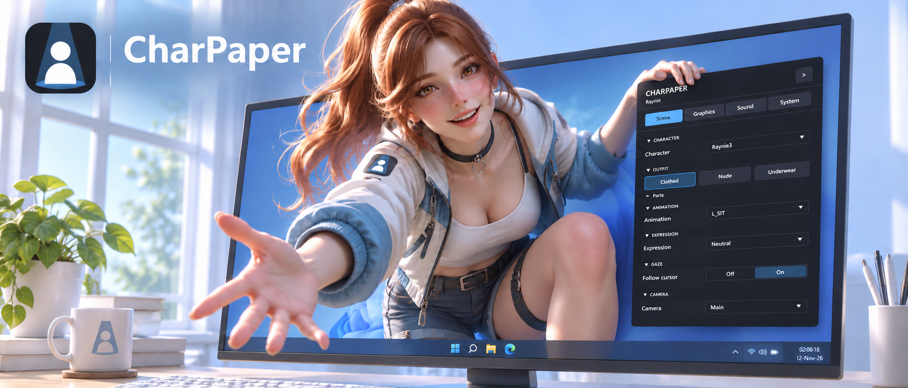

<h1 align="center">CharPaper</h1>

  A live 3D character for your Windows desktop, behind your icons.

  
  

 

  

  <b>Recommended.</b> The latest tested version. 
  On the page that opens, click <b>charpaper-…-windows-x64.zip</b> under <b>Assets</b>.

 

  

  <b>For the curious.</b> Built automatically from every change, so it has the newest features 
  and may have new bugs. The download starts right away.

 

CharPaper draws a 3D scene with a character where your wallpaper is: behind the desktop
icons, in real time. You can change the character's outfit, animation and expression, look
around with the mouse, switch cameras and surroundings, and tune the picture, all from a
panel on the desktop.

Characters are made in Blender and exported with the add-on that comes with CharPaper.
If you are a 3D artist, [Making a character](docs/making-a-character.md) is written for you.

## Quick start

1. Download one of the two above and extract the `.zip` somewhere in your own folders,
   like Documents.
2. Put a character folder into `characters`. **CharPaper comes with none**: get one from
   its author, or [make your own](docs/making-a-character.md).
3. Double-click **charpaper.exe**.

You need Windows 10 or 11 (64-bit) and a processor with AVX2.
[Getting started](docs/using.md#getting-started) has the details, including what to do when
Windows says it protected your PC.

## Find what you need

| I want to… | Read |
|---|---|
| Install, update or remove CharPaper | [Getting started](docs/using.md#getting-started) · [Where your settings live](docs/using.md#where-your-settings-live) |
| Change the outfit, animation, camera or picture | [The panel](docs/using.md#the-panel) |
| Turn the view with the mouse | [The mouse on the desktop](docs/using.md#the-mouse-on-the-desktop) |
| Use two or more monitors | [Several monitors](docs/using.md#several-monitors) |
| Know why it stopped moving, or save battery | [When it pauses](docs/using.md#when-it-pauses) |
| Fix a problem with the app | [When something goes wrong](docs/using.md#when-something-goes-wrong) |
| Start it in a window, or from a script | [Command line](docs/using.md#command-line) |
| Make my first character in Blender | [Your first character, step by step](docs/making-a-character.md#your-first-character-step-by-step) |
| Add outfits, animations or expressions | [Recipes](docs/making-a-character.md#recipes) |
| Build a place for the character, with lights | [An environment](docs/recipes/environment.md) · [A sky](docs/recipes/sky.md) · [A sun that matches the sky](docs/recipes/sun.md) · [Fog](docs/recipes/fog.md) |
| Make the character look at the cursor | [Following the cursor (gaze)](docs/recipes/gaze.md) |
| Add cameras, sounds or a color grade | [A camera](docs/recipes/camera.md) · [Sounds](docs/recipes/sounds.md) · [A color grade](docs/recipes/lut.md) |
| Edit a character's settings by hand | [suite.toml](docs/suite-toml.md) |
| Fix a character that looks or loads wrong | [Troubleshooting for artists](docs/troubleshooting.md) |
| Keep my scene light on the computer | [Keeping it fast](docs/performance.md) |
| Translate the panel, or build CharPaper | [Translating and building](docs/development.md) |

**[All the docs, page by page](docs/README.md)**

## License

- **The app**, which is everything in `crates/`, `locales/`, `schemas/` and `packaging/`, is
  under your choice of the [MIT](LICENSE-MIT) or the [Apache 2.0](LICENSE-APACHE) license.
- **The Blender add-on** is under the [GPL 3.0 or later](tools/blender/charpaper_exporter/LICENSE),
  as add-ons that run inside Blender must be.
- **The artwork** is © Zirael, all rights reserved: the app icon in `crates/charpaper/icon/`,
  the banner in `resources/images/`, and the images in `site/`. The licenses above don't
  cover it, so a fork needs its own icon and images. Sharing CharPaper's official downloads
  as they are is fine.
- **The website's fonts**, Inter, Space Grotesk and JetBrains Mono, are under the SIL Open
  Font License. Their licenses are in [`site/fonts/`](site/fonts).
- **Characters you make** are yours. CharPaper's licenses don't cover them, or the files the
  add-on exports for them.

Every release download includes the license texts and `THIRD-PARTY-LICENSES.html`, which
lists every library built into the app and its license.

Unless you say otherwise, anything you contribute to the app is licensed as MIT or Apache 2.0
like the rest of it, and anything you contribute to the add-on as GPL 3.0 or later.
